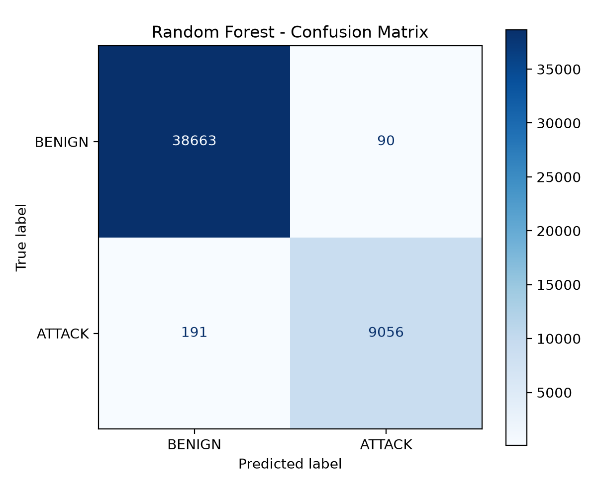
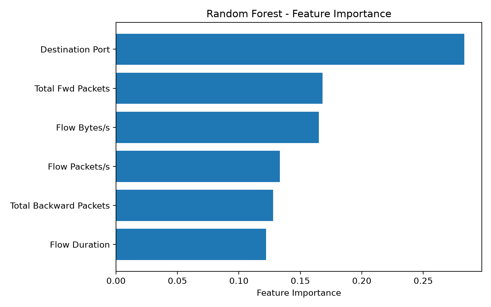

# Large-Scale Network Traffic Analysis and Cyberattack Detection

### Using Hadoop MapReduce and Random Forest Machine Learning

## Project Overview

This project analyzes large-scale network traffic data to identify cyberattack patterns using **Apache Hadoop MapReduce** and a **Random Forest Classifier**.

The system processes the CIC-IDS2017 dataset to analyze attack frequencies, suspicious destination ports, and network traffic characteristics. A Random Forest model is trained to classify network traffic as **BENIGN** or **ATTACK**.

**Random Forest Test Accuracy: 99.41%**

## Technologies Used

- Apache Hadoop 3.5.0
- Hadoop Distributed File System (HDFS)
- Hadoop Streaming and MapReduce
- Python 3
- Pandas and NumPy
- Scikit-learn
- Matplotlib
- Joblib
- Ubuntu (WSL)

## Dataset

**Dataset:** CIC-IDS2017

**Source:** https://www.unb.ca/cic/datasets/ids-2017.html

The dataset contains **2,830,743 network traffic records** across eight CSV files, representing benign traffic and multiple cyberattack categories.

The full dataset is not included in this repository because of its size.

## System Architecture

```text
CIC-IDS2017 Dataset
        |
        v
   Hadoop HDFS
        |
        v
 Hadoop MapReduce
        |
        +--> Attack Frequency Analysis
        |
        +--> Destination Port Analysis
        |
        +--> Traffic Pattern Analysis
        |
        v
   Analysis Results

CIC-IDS2017 CSV Files
        |
        v
 Data Preprocessing
        |
        v
 Random Forest Classifier
        |
        v
 BENIGN / ATTACK Prediction
        |
        v
 Model Evaluation and Visualizations
```

## Hadoop MapReduce Analysis

### 1. Attack Frequency Analysis

The MapReduce program counts network traffic records by attack category.

| Traffic Category | Records |
|---|---:|
| BENIGN | 2,273,097 |
| DoS Hulk | 231,073 |
| PortScan | 158,930 |
| DDoS | 128,027 |
| DoS GoldenEye | 10,293 |
| FTP-Patator | 7,938 |
| SSH-Patator | 5,897 |

The complete results are available in `results/attack_counts.txt`.

### 2. Destination Port Analysis

The system counts malicious traffic records associated with destination ports.

| Destination Port | Malicious Records |
|---|---:|
| 80 | 383,239 |
| 21 | 8,181 |
| 22 | 6,140 |
| 8080 | 1,421 |
| 443 | 240 |

Port 80 accounts for approximately **68.7% of malicious records** in this dataset.

Complete results: `results/port_counts.txt`.

### 3. Traffic Pattern Analysis

The system calculates average flow duration and packet counts for different traffic categories.

Examples include:

- **DDoS:** Average flow duration of approximately 16.96 seconds.
- **PortScan:** Average flow duration of approximately 0.083 seconds.
- **DoS Hulk:** Average flow duration of approximately 57.08 seconds.

Complete results: `results/traffic_patterns.txt`.

## Random Forest Machine Learning

A Random Forest classifier predicts whether a network traffic record is benign or malicious.

### Selected Features

1. Destination Port
2. Flow Duration
3. Total Forward Packets
4. Total Backward Packets
5. Flow Bytes/s
6. Flow Packets/s

### Training and Testing

| Parameter | Value |
|---|---|
| Sampled records | 240,000 |
| Training records | 192,000 |
| Testing records | 48,000 |
| Training/testing split | 80% / 20% |
| Algorithm | Random Forest |
| Decision trees | 50 |
| Maximum tree depth | 15 |

### Model Performance

**Accuracy: 99.41%**

Confusion Matrix:

| Actual / Predicted | BENIGN | ATTACK |
|---|---:|---:|
| BENIGN | 38,663 | 90 |
| ATTACK | 191 | 9,056 |

The classifier correctly predicted **47,719 out of 48,000 test records**.

This accuracy was measured using a random record-level train/test split. It represents baseline performance on the sampled CIC-IDS2017 data, not guaranteed performance on unseen network environments or attack types.

### Model Visualizations

**Confusion Matrix**



**Feature Importance**



## Project Structure

```text
network-traffic-attack-analysis/
├── src/
│   ├── mapper.py
│   ├── reducer.py
│   ├── port_mapper.py
│   ├── traffic_mapper.py
│   ├── traffic_reducer.py
│   ├── train_random_forest.py
│   └── visualize_ml.py
├── results/
│   ├── attack_counts.txt
│   ├── port_counts.txt
│   └── traffic_patterns.txt
├── ml_results/
│   ├── confusion_matrix.png
│   └── feature_importance.png
├── screenshots/
├── docs/
├── requirements.txt
├── .gitignore
└── README.md
```

## How to Run the Machine Learning Model

1. Clone this repository and enter its directory.
2. Install the required Python libraries:

```bash
python3 -m venv ml_env
source ml_env/bin/activate
pip install -r requirements.txt
```

3. Download the CIC-IDS2017 MachineLearningCSV dataset and extract the eight CSV files into a directory named `MachineLearningCVE` in the project root.
4. Train the Random Forest model:

```bash
python src/train_random_forest.py
```

5. Generate the visualizations:

```bash
python src/visualize_ml.py
```

The model and generated images will be saved in `ml_results/`.

## Limitations

- The Random Forest evaluation uses a random record-level split, which may overestimate generalization to unseen traffic.
- The machine learning model is trained locally using scikit-learn; Hadoop MapReduce performs the distributed traffic analysis.
- The selected CIC-IDS2017 CSV files do not contain source IP addresses or original timestamps, so source-IP frequency and time-based request bursts are not analyzed.
- The system is an offline analysis prototype, not a real-time intrusion prevention system.

## Conclusion

This project demonstrates how **Hadoop MapReduce** can process millions of network traffic records and how **Random Forest Machine Learning** can classify benign and malicious traffic.

The implementation achieved **99.41% baseline test accuracy**, demonstrating the effectiveness of combining distributed data analysis with supervised machine learning for cybersecurity research.

## Dataset Attribution

Canadian Institute for Cybersecurity, University of New Brunswick — CIC-IDS2017.

https://www.unb.ca/cic/datasets/ids-2017.html
